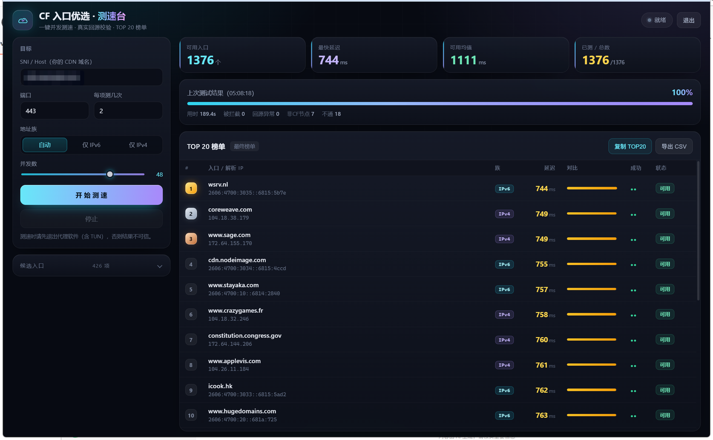

# CF-Pick · Cloudflare 入口优选测速台

> 一键并发测速几百个 Cloudflare 优选域名 / IP，**真实回源校验**，实时输出 TOP 20 榜单。
> 单文件 Windows 应用，双击即用，不需要装 Python、不需要命令行。




<sub>真实测速结果截图。延迟数值随网络环境与时段变化，仅作界面示意。</sub>

---

## 它解决什么问题

用 Cloudflare 中转的节点（VLESS-WS-TLS / Trojan-gRPC 之类），客户端连的是「优选入口」而不是源站。
常见做法是抄一份公共优选域名清单，或者用 CloudflareSpeedTest 扫 IP —— 但这两种做法都有同一个盲区：

**它们只测「你 → CF 边缘」这一段，测不出「CF 边缘 → 你的源站」这一段。**

CFST 默认测的是 `speed.cloudflare.com`，请求在 CF 边缘就被应答了，根本不会回源到你的机器。
所以它排名第一的 IP，装到你的节点上未必好用 —— 你测到的是 CF 的缓存节点，不是你的线路。

**CF-Pick 的做法是复刻真实代理行为**：连到候选 IP，用**你自己的域名做 SNI** 完成 TLS 握手，再发一个普通 HTTP 请求。
CF 按 SNI 认出你的 zone 并回源，于是这个耗时天然包含两段：

```
你的电脑 ────[这段优选能优化]──── CF 边缘 ────[这段优选管不了]──── 你的源站
              └──────────── 本工具测的就是这条完整路径 ────────────┘
```

顺带能筛掉三类「假可用」入口：

| 情况 | 现象 | 本工具判定 |
|---|---|---|
| 域名没走 CF（灰云） | 直连到别人的服务器，照样返回 404 | `非CF节点`，拒绝排名 |
| 落在 CF 中国合作节点 | 172.64.52.x 之类的京东云节点，仅服务企业版 | `被CF拦截`（403） |
| 源站没起来 / 证书错 | CF 自己报错 | `回源异常`（52x/530） |

---

## 特性

- **一键跑完全程**：内置 414 个在用的优选域名，点一下 ≈ 75 秒出榜（并发 40，每项 2 次取均值）
- **真实回源**：内置 CF 官方 22 个网段（15×IPv4 + 7×IPv6）+ CF 自有 AS（`cf-asn.txt`）校验，两者都不沾的地址一律剔除
- **IPv4 / IPv6 分开测**：同一个域名同时测 A 与 AAAA，榜单上直接标出谁更快
- **实时榜单**：进度、可用数、最快/均值延迟、拦截与超时统计边跑边更新
- **一键取用**：「复制 TOP20」直接粘进 v2rayN / Clash 的地址栏；「导出 CSV」带 BOM，Excel 不乱码
- **测速前先查代理**：分两档 —— 系统代理 / PAC / WinHTTP / 代理进程只弹一次提示（裸 socket 直连不受它们影响，可以「仍要测速」），TUN / 虚拟网卡才真的拦下来
- **四套配色随手切**：暗色 / 亮色 / 粉色 / 橙色，选完记进配置
- **自绘标题栏**：无边框窗口，页头就是标题栏，拖动 / 双击最大化 / 八向拉伸都在页面里做
- **零依赖运行**：单文件 exe，配置与候选清单写在 exe 同级，换目录不影响
- **源码干净**：纯标准库（`socket` / `ssl` / `http.server`），前端是单个 `ui.html`，没有框架、没有 npm

---

## 快速开始

1. 到 [Releases](https://github.com/Vardven/CF-Pick/releases) 下载 `CF-Pick.exe`
2. **代理开着也没关系**（v2rayN / Clash 的系统代理、PAC 都不影响，本工具用裸 socket 直连）—— 只有 TUN / 虚拟网卡会真的改变链路，那种情况点「开始测速」时会自动体检并拦下来
3. 双击 `CF-Pick.exe` —— 直接弹出程序自己的窗口（**不是浏览器标签页**，没有地址栏、没有标签栏，任务栏上是它自己的图标）
4. 左侧填你的 **SNI / Host**（就是你在 CF 里开了橙云的那个子域，例如 `cdn-test.example.com`）—— 这一栏出厂是**空的**，框里那行灰字只是提示不算填写；不确定填什么就空着点「开始测速」，输入框会标红并就地展开一段说明（标签旁的「?」也能随时调出来）
5. 展开左侧最下面的 **候选入口**，点「导入」挑一套清单（**这一栏出厂也是空的**，不导入就没东西可测）：
   - **优选域名库** —— 内置 414 个在线优选域名，最省事，直接测
   - **CF 官方 IP 段** —— Cloudflare 公布的 22 个边缘网段（含 7 个 IPv6），每段撒点，共 66 个入口
   - **AS13335 网段**（150）/ **AS209242 网段**（60）—— 各自 AS 宣告的 IPv4 网段里均匀撒点

   > AS395747、AS202623 这两个 AS 已经**从预置里去掉**：它们的段全球都有 BGP 路由，但 443 上没有任何 HTTP 服务，实测 0/70 全超时，扫了纯浪费时间。留着它们只是为了判定时能认出「这是 CF 的机器，只是不通」，不会误报成「非CF节点」。
   导入是**追加并自动去重**，重复点同一套只会提示"已经在列表里了"；想重来先点「清空」。改完点「保存并应用」（不改也行，点开始测速会自动带上当前内容）
6. 点「开始测速」，等进度跑完，看右侧 TOP 20
7. 点「复制 TOP20」拿到的是 `IP:端口` 清单（一行一个），回客户端里把节点**地址和端口**换成榜单里那一条；SNI / 路径 / ALPN 一律不动

> exe 放到了只读目录（如 `Program Files`）也能跑，配置文件会自动落到 `%LOCALAPPDATA%\CF-Pick`。

### 关于双击后那几秒

单文件 exe 双击后需要先把内置的 Python 运行时解压到临时目录（首次启动还要过一遍杀毒扫描），所以会等 1–3 秒窗口才出来。为了不让人以为没点着而连点几次，做了三件事：

- **启动画面**：双击后立刻弹出一张深色小窗（解压阶段是静态图，程序一起来就换成自绘窗口接着走），进度条从左往右涨、一道流光循环扫过，下面一行写清当前在干什么 —— 「正在检查运行环境 / 正在载入界面 / 本地服务已就绪 · 端口 xxxx / 正在渲染界面 / 准备就绪」。走完 100% 会在主界面上方淡出，所以看到的是「进度条走完 → 界面已经在那儿了」，不会闪白或闪空
- **单实例保护**：重复双击不会开出第二个测速台，第二个进程会通知已经在跑的那个把窗口叫到前台，然后自己退出
- **托盘常驻**：窗口收进托盘后（见下面「用完怎么退」），托盘图标就是回到界面的入口（Win11 默认收在折叠区，可在 设置 → 个性化 → 任务栏 → 系统托盘图标 里打开）

### 独立窗口是怎么来的

界面本身还是那套 HTML，由程序内部的本地服务（`127.0.0.1:5390` 起）提供；窗口用 Edge 的 **WebView2** 内核渲染 —— 也就是 Edge 浏览器同款引擎，只是被包进程序自己的窗口里，所以：

- 没有地址栏 / 标签页 / 书签栏，也**没有系统标题栏**：窗口是无边框的，最上面那条就是页面自己的页头，右上角那组按钮也是画在页面里的
- **拖窗口**：按住页头空白处（别按在按钮上）拖动；**双击页头** = 最大化 / 还原；拖到屏幕顶端也会最大化
- **改大小**：拉窗口的四条边和四个角都行，最小 960×620；最大化状态下不能拉
- 关掉窗口 = 收进托盘，不会连带把浏览器也关掉
- 不依赖你装没装 Chrome，也不会往浏览器里塞标签页

WebView2 运行时 Win10/11 基本都自带（Edge 装着就有）。万一系统里确实没有，程序会**自动退回浏览器模式**：开一个 `--app` 窗口，功能一模一样，只是外壳是浏览器的（这时候页头不负责拖动，缩放热区也不显示）。想强制用浏览器模式，设环境变量 `CF_PICK_BROWSER=1` 再启动即可。

### 配色：暗色 / 亮色 / 粉色 / 橙色

右上角的**调色板按钮**里可以随时换热配色，选完立刻生效并记进配置文件，下次打开还是这一套：

| 配色 | 适合 | 说明 |
|---|---|---|
| **暗色**（默认） | 夜里、长时间盯榜 | 青 + 紫强调色，原来的那套 |
| **亮色** | 白天、投屏、打印截图 | 浅灰底 + 白卡片 + 深字，对比度按 WCAG AA 调过 |
| **粉色** | 换个口味 | 深底 + 玫红 / 紫罗兰强调色，可用 / 不可用仍是绿 / 红 |
| **橙色** | 换个口味 | 暖黑底 + 橙 / 暖金强调色，可用 / 不可用仍是绿 / 红 |

界面里所有颜色都走 CSS 变量（`--t1`…`--t5` 文字、`--c1/--c2` 强调、`--ok/--warn/--bad` 语义色），四套主题只是换一组变量值，所以布局和交互在四套配色下逐像素一致。粉色 / 橙色只换主色调和底纹，**语义色（可用绿、不可用红）不动** —— 换配色不会让榜单读岔。

### 重复打开 exe 不会再多开窗口

第二次双击 exe 时不会又冒一个测速台出来：

1. 若窗口正开着：直接把它切到前台
2. 若窗口已经收进托盘：先把它显示出来，再切到前台，**已测的结果、填好的参数原样都在**
3. 第二个进程做完这两件事就自己退出，不会常驻

### 用完怎么退

右上角那排按钮是 **调色板 / 最大化 / − / ✕**（中间一条竖线隔开窗口按钮）。点 `✕` 会在页面里弹对话框让你二选一，不会点了就杀进程：

- **「收进系统托盘」** = 后台继续待命（服务还在，端口继续占着，下次秒开）
- **「彻底退出」** = 停测速 → 关服务 → 释放端口 → 结束进程
- 点「取消」或按 `Esc` 什么都不做

想直接结束进程也可以走托盘图标右键 → 彻底退出。

选「收进系统托盘」后窗口只是藏起来，**不刷新、不丢已测结果**。要回到界面，任选一种：

- 双击托盘图标（或托盘右键 → 打开测速台）
- 再双击一次 `CF-Pick.exe`

选「彻底退出」后界面会盖一层「正在退出并释放端口…」的进度遮罩（停止测速 → 关闭本地服务 → 释放端口），随后进程结束、托盘图标一起消失；下次双击 exe 是全新启动。浏览器模式下这一页会留着并自动变回「已退出 · 端口已释放」，再双击 exe 会自己刷新回来。

### 右上角那盏灯

界面右上角的胶囊是**真实连接状态**，不是装饰：

- **绿点「就绪」**：本机服务在线，可以测速
- **蓝点「测速中」**：正在跑，跑完短暂显示「完成」再回到「就绪」
- **灰点「未就绪」**：程序已经退出（或被别的程序顶掉了端口），左栏会出现橙色提示，测速按钮置灰

旁边的「端口 `127.0.0.1:5390`」是**本次运行真实占用的本地服务端口**（5390–5405 里第一个空闲的，被别人占了就顺延）。点一下就能把完整地址复制走，排查端口冲突时也看这里。

页面每 2.5 秒回探一次服务（收进托盘时缩到 0.7 秒，好让托盘的操作马上生效），所以后台一退出，灯会立刻变灰。

### 测速前的代理检查

点「开始测速」时先做一次体检，分两档处理：

| 档位 | 检查项 | 命中示例 | 处理 |
|---|---|---|---|
| **拦下** | 虚拟网卡 / 隧道 | TUN 模式的 `Clash` / `wintun` / `WireGuard` / 系统 VPN 连接 | 必须关掉才能测，只给「重新检测」 |
| 提示 | 系统代理 | Internet 选项里勾了代理，`127.0.0.1:10808` | 弹一次说明，可点「仍要测速」或勾「以后不再提示」 |
| 提示 | PAC 自动代理 | 配了 `AutoConfigURL`（Clash / 公司网关常见） | 同上 |
| 提示 | WinHTTP 代理 | `netsh winhttp set proxy` 设过 | 同上 |
| 提示 | 代理进程 | `v2rayN` / `verge-mihomo` / `clash` / `xray` / `sing-box` / `shadowsocks` 等 | 同上 |

分档的原因：本工具用**裸 socket 直连候选 IP**，系统代理 / PAC / WinHTTP 只对「愿意遵守它」的软件生效（浏览器、curl 这类），根本改不了这里的路径 —— 常驻 v2rayN、Clash 的人被它们挡住没有任何道理。只有 **TUN / 虚拟网卡**在路由层把流量抓进隧道，测出来才会变成「你 → 代理」的延迟，所以那一档永远拦，后端也会再拦一次，绕过界面直接调接口同样不行。

勾了「以后不再提示」会写进配置（`skip_env_check`），只对上面那几行「提示」生效，TUN 照样拦。想恢复提醒就改回 `false`。

两点特意没做：**不看 `HTTP_PROXY` 环境变量**（很多工具给自己用，不代表浏览器走代理，容易误报），**不看常驻服务进程**（`clash-verge-service.exe` 这类开机就在跑，代理没开也会误判）。系统里残留但已关闭的代理配置也不拦 —— 只看「现在是否真的在用」。

关掉 TUN 后点弹窗里的「重新检测」，通过就自动开始测速，不用再点一次按钮。只开了系统代理 / 代理进程时点「仍要测速」即可直接开跑。

### 界面

| 区域 | 说明 |
|---|---|
| 左栏 · 目标 | SNI/Host、端口（CF 代理的 6 个 HTTPS 端口可多选，勾几个就并行测几个）、每项测试次数、并发数、地址族（自动 / 仅 v6 / 仅 v4） |
| 左栏 · 候选入口 | 出厂空白。点「导入」可选优选域名库 / CF 官方 IP 段 / 四个 CF AS 网段，追加去重；也可直接粘贴，一行一个域名或 IP |
| 中部 KPI | 可用入口数、最快延迟、可用均值、已测/总数 |
| 中部进度 | 解析阶段 → 探测阶段，右侧统计被拦截 / 回源异常 / 非CF / 不通 |
| 右侧榜单 | 前十名金银铜标记，延迟条横向对比，点任意一行复制 `IP:端口`（IPv6 自动加方括号） |

### 窗口大小

左栏是自适应的，拖小窗口不会把按钮挤没：

- **目标卡片**负责让步：放不下时它自己内部滚动，右栏的字号与间距按高度分三档收紧（980 / 840 / 720）。
- **候选入口抽屉**吃掉左栏剩余高度，只有文本框跟着伸缩，`导入 / 清空 / 保存并应用` 一直贴在抽屉底部。高度不足 840px 时两条解释性提示自动收起，720px 以下「开始测速 / 停止」改成并排。
- 窗口拉得很窄（或高 DPI 缩放后可视宽度不到 920px）时，布局转成上下两栏整页滚动；1040px 以下榜单会自动省掉「对比」列，把宽度让给域名。

---

## 判定规则

只认 **HTTP 状态码**，不看延迟高低：

| 状态 | 含义 | 能不能用 |
|---|---|---|
| `200` `301` `400` `404` … | 请求到达你的源站，被正常应答或拒绝普通请求 | ✅ 可用 |
| `403` | CF 层就拒了：Host/SNI 不对，或该 IP 是 CF 中国合作节点 | ❌ 被CF拦截 |
| `521` `522` `523` `525` `530` | CF 连不上 / 握不上 / 解析不到你的源站 | ❌ 回源异常 |
| `000` / 超时 | 根本没连上 | ❌ 淘汰 |
| IP 既不属官方 15 段、也不属 CF 自有 AS | 该域名没走 CF | ❌ 非CF节点 |

> 返回 `404` 是**最好的结果**：说明 CF 成功回源到了你的机器，只是你那条 WS 入站不接受普通 GET 请求，于是自己回了个 404。

**关于「非CF节点」的判定口径**：CF 官方公布的 15 个 IPv4 段只是「代理域名会被解析到的那几段」，并不等于「CF 的全部地址」。AS209242（Spectrum 的池子）、AS395747、AS202623 这些 CF 自有 AS 在 RIPE 登记的段（比如 `45.131.4.0/22`、`68.169.48.0/20`）基本都不在那 15 段里，但它们确实是 CF 的机器。所以程序现在按「官方段 ∪ CF 自有 AS 段」判定，落在 AS 段里的条目照样测，只是在 IP 后面标一个小 AS 号，方便你区分来源。

不过要清楚这些池子的实际成色（2026-11-23 实测，SNI 用真实域名、直连不走代理）：

| 库 | 抽样 | 可用 | 说明 |
|---|---|---|---|
| AS13335 | 150 | **127（85%）** | 橙云 zone 真正用的 anycast 池，主力 |
| AS209242 | 60 | **20（33%）** | Spectrum 的池子，一部分与 HTTP 边缘同机所以能通，可用率低且不稳定 |
| AS395747 | 40 | **0** | 只挂特定 PoP 的特定服务，443 无服务 → 全超时，**已从预置移除** |
| AS202623 | 30 | **0** | core 内部用途，同样 443 无服务 → 全超时，**已从预置移除** |

后两个 AS 的段在 RIPE RIS 上是 100% 全球可见的（321/321 peer 都有路由），所以不是「没广播」，而是「广播了但 443 上没人听」，SYN 被丢弃 → 表现为超时。**优选只扫官方段 / AS13335 就够了**，AS209242 当补充碰运气。

---

## 参数说明

| 参数 | 默认 | 说明 |
|---|---|---|
| SNI / Host | — | 你开了橙云的 CDN 子域，TLS 握手和 `Host` 头都用它 |
| 端口 | `443` | 六个格子是 CF 代理的全部 HTTPS 端口：`443` / `8443` / `2053` / `2083` / `2087` / `2096`。**可以多选**，勾几个就同时测几个 —— 同一个 IP 在不同端口上算两条独立结果、各自排名，榜单多一列「端口」。至少留一个；并发是全局的，所以勾 3 个端口时总任务数 ×3，慢一点是正常的 |
| 每项测几次 | `2` | 取成功次数的平均值；网络抖动大就调到 3 |
| 并发数 | `32` | 太高容易被运营商 QoS，64 是上限 |
| 地址族 | 自动 | 自动 = A + AAAA 都测，各取前 2 个地址 |
| 候选入口 | 空 | 不导入也不粘贴就没什么可测；导入的 IP 是「网段撒点」，不是全量扫段 |

> AS 网段库 `cf-asn.txt` 生成于 2026-11-23，数据来自 RIPE Stat 的 `announced-prefixes`：AS13335 收 2772 段、AS209242 收 260 段、AS395747 收 19 段、AS202623 收 12 段（只收 IPv4，v6 段不计）。想刷新就重新拉 `https://stat.ripe.net/data/announced-prefixes/data.json?resource=AS13335` 覆盖这个文件，格式是 `[ASxxxxx] 名称` 开头、后面每行一个前缀。

---

## 常见问题

**测出来和我实际用起来的体验对不上？**
先确认测速时**没开 TUN**。系统代理开着无所谓（本工具裸 socket 直连，不吃系统代理），但 TUN 模式在路由层劫持流量，会让所有候选都变成「你 → VPS → CF」的绕行路径，数据全废。

**为什么延迟和我之前用 curl 脚本测的不一样？**
本工具把 DNS 解析放在测速之前单独做，计时只算「连接 + TLS + 首字节」；`curl --connect-to` 会把 DNS 也算进 `time_total`。**同一份清单换个工具会差 200ms 左右，跨工具别横比，看排名。**

**杀毒软件报毒？**
PyInstaller 单文件 exe 的自解压特征会触发误报，加信任即可。介意的话按下面的步骤自己从源码打包。

**一定要选 IPv6 吗？**
不一定，但实测差得很明显 —— 同一条宽带下 v6 入口常在 300ms 档，v4 在 500ms 档。前提是你的 VPS 有可用 IPv6 出口。

**榜单里同一个域名出现两三次？**
那是它解析出的不同 IP / 不同地址族，各自独立测速。想要「一个域名只留最快一条」，可以按延迟手动挑，或者在客户端里只保留排名最高的那行。

**点了「导入 → 优选域名库」，再点开始测速却提示「候选列表是空的」？**
这是 1.1.0 及更早版本的一个 bug：早期为了抹掉老版本自动灌进来的默认清单，程序在**每次读取候选**时都拿文件内容和内置清单比对，一旦相等（也就是你导入的正好是优选域名库）就把文件清空 —— 于是页面上明明列着几百条，后台却是空的。
1.1.1 起改成「一个数据目录只在第一次启动时迁移一次」，导入的清单不会再被删。升级后重新点一次「导入」即可。

---

## 从源码构建

```bash
git clone https://github.com/Vardven/CF-Pick.git
cd CF-Pick

python -m pip install pyinstaller pywebview
python gen_icon.py            # 生成 icon.ico（纯标准库，不需要 Pillow）

# Windows（--add-data 用分号；--collect-all webview 是内嵌窗口要用的 WebView2 DLL）
python -m PyInstaller --noconfirm --onefile --noconsole --name CF-Pick ^
  --icon icon.ico --collect-all webview --hidden-import webview.platforms.winforms ^
  --hidden-import clr --add-data "ui.html;." --add-data "cf-domains.txt;." ^
  --add-data "cf-asn.txt;." cfpick.py

# macOS / Linux（--add-data 用冒号，产物不是 exe；内嵌窗口只做 Windows，
# 这两边会走浏览器模式，可以不装 pywebview）
python -m PyInstaller --noconfirm --onefile --name CF-Pick \
  --add-data "ui.html:." --add-data "cf-domains.txt:." --add-data "cf-asn.txt:." cfpick.py
```

Windows 上也可以直接双击 `build.cmd`。

内嵌窗口依赖 [pywebview](https://pywebview.flowrl.com/)（`pip install pywebview`）和系统的 Edge WebView2 运行时。缺任一个都不会崩，只是退回浏览器模式。

只调试界面的话，`ui.html` 用浏览器直接打开即可 —— 会加载一份内置的演示数据。

### 版本号与发布节奏

推一个 `v*` 的 tag 就会自动构建并发布。tag 名决定它是预发布还是正式版：

| tag 形式 | 发布类型 | 用途 |
|---|---|---|
| `v1.0.8-rc`（固定名，反复覆盖） | **滚动预发布**（Pre-release） | 一条开发线只用这一个，改动攒着一起更新 |
| `v1.0.8` | 正式版，会自动成为 Latest | 这条开发线收尾时打 |

预发布是**滚动**的：同一条开发线始终只占 Releases 里的一条记录，每次推上去就覆盖旧包，不会为一处小改动多开一个版本。release 正文会自动列出「自上个正式版以来的所有改动」，看一眼就知道这批包里都有什么。

发正式版时打不带后缀的 tag（`v1.0.8`），它会成为 Latest；要开始下一批改动时再换 `v1.0.9-rc` 继续滚动。

`gen_splash.py` 画出来的 `splash.png` 必须和 `cfpick.py` 里自绘启动窗的第一帧对齐（`SPL_W` / `SPL_H` / `_spl_text` 的坐标），改任何一边都要同步另一边，否则换窗那一下会看到跳变。

### 目录结构

```
CF-Pick/
├─ cfpick.py                     # 测速引擎 + 本地 HTTP 服务（纯标准库）
├─ ui.html                       # 界面（原生 JS，无框架）
├─ gen_icon.py                   # 生成多尺寸 ICO
├─ gen_splash.py                 # 生成启动画面 splash.png
├─ icon.ico
├─ splash.png
├─ cf-domains.txt                # 内置候选清单（一行一个）
├─ build.cmd                     # Windows 一键打包
├─ docs/screenshot.png           # README 界面截图
└─ .github/workflows/release.yml # 打 tag 自动构建并发布
```

---

## 原理备注

每个候选都会被执行：

1. `getaddrinfo` 解析出 IPv4 / IPv6 地址，逐个校验是否落在 CF 官方的 22 个网段内
2. `socket.connect` 连到候选地址（**不是**连你的域名，这一步就是优选的全部意义）
3. `SSLContext.wrap_socket(server_hostname=<你的 SNI>)`，ALPN 固定 `http/1.1`
4. 发送 `GET / HTTP/1.1` + `Host: <你的 SNI>`
5. 读首字节，计时结束，按状态码分类

任何一个候选出问题，只会影响它自己那一行 —— 不会让整轮测试崩掉。

---

## 免责声明

本项目仅用于网络质量测试与线路诊断。使用者应自行确保其使用方式符合所在地法律法规及所接入服务商的条款。作者不对任何因使用本工具产生的后果承担责任。

## License

[MIT](LICENSE) © Vardven
